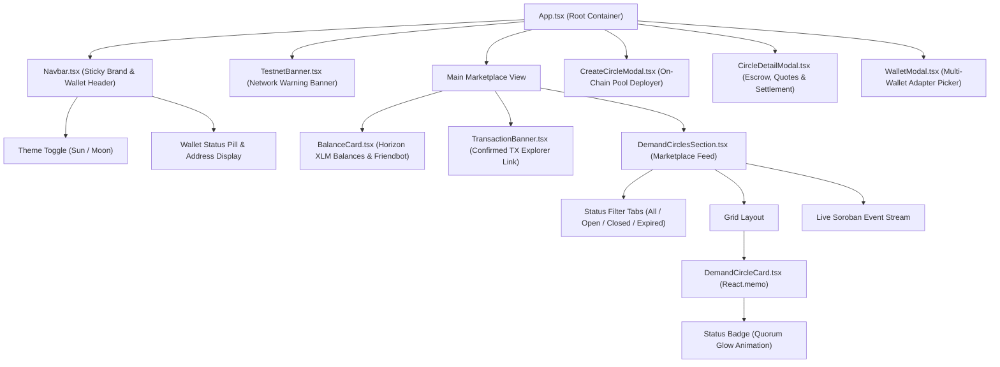

# Stellar Bazaar Frontend: Component Hierarchy & Architecture

This document maps the React component hierarchy, data flow, and state boundaries for the **Stellar Bazaar** decentralized application.

---

## 1. Visual Component Hierarchy

---

## 2. Component Specifications

### 1. `Navbar.tsx`
- **Responsibilities**: Sticky navigation, brand identity, Testnet network indicator, light/dark theme toggler, connected account pill with copyable public address, and wallet disconnect control.
- **Accessibility**: 48px minimum touch tap targets on mobile, screen-reader status indicators.

### 2. `DemandCircleCard.tsx`
- **Responsibilities**: Memoized (`React.memo`) presentation card for individual commercial demand circles. Renders target unit volumes, max unit price in XLM, expiry countdown, and pulsating glow badge when quorum is achieved.
- **Props**: `circle: OnChainDemandCircle`, `onSelect: (circle: OnChainDemandCircle) => void`.

### 3. `CircleDetailModal.tsx`
- **Responsibilities**: Multi-tab interactive modal handling 4 phases of commerce:
  1. **Overview**: Circle metrics, on-chain creator address, metadata URI, and current escrow volume.
  2. **Commit Demand**: Buyer capital escrow deposit form with simulation and SAC token transfer.
  3. **Submit Offer**: Merchant quotation form specifying unit price, delivery volume, and lead time days.
  4. **Settlement**: Seller offer acceptance, escrow payout release, and buyer refund claims.
- **Accessibility**: Trap focus, Escape key listener (`useModalBackdrop`), `role="dialog"`, `aria-modal="true"`.

### 4. `TransactionBanner.tsx`
- **Responsibilities**: Toast / persistent status banner indicating confirmed on-chain transactions on Stellar Testnet with direct deep links to Stellar Expert Explorer.

### 5. `CopyButton.tsx`
- **Responsibilities**: Accessible copy button with 2-second visual checkmark confirmation and `aria-live` region.
